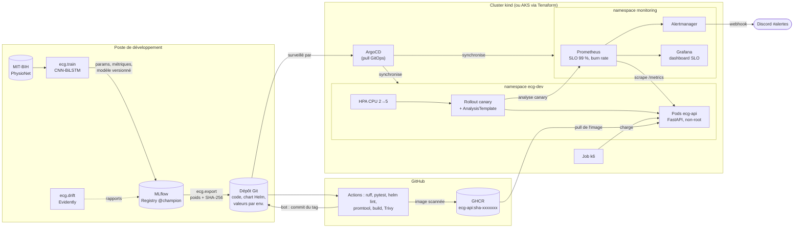
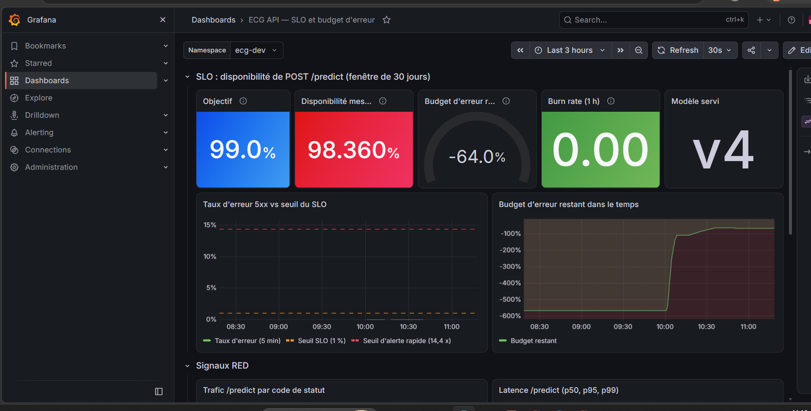
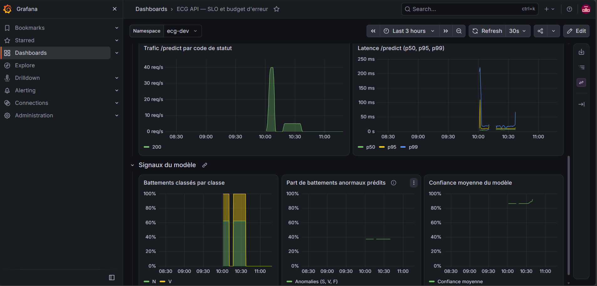
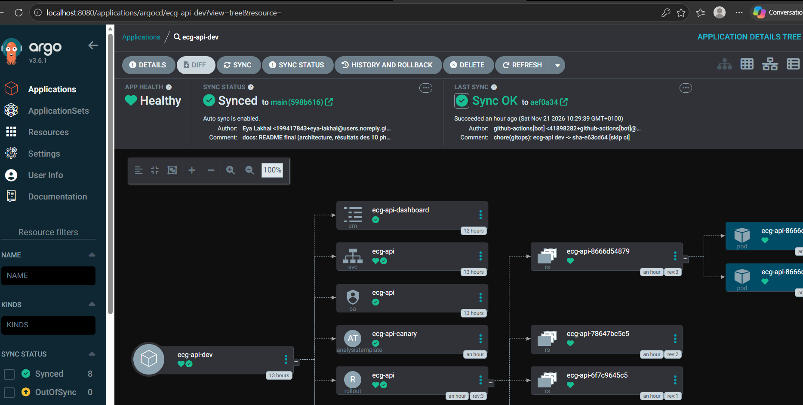
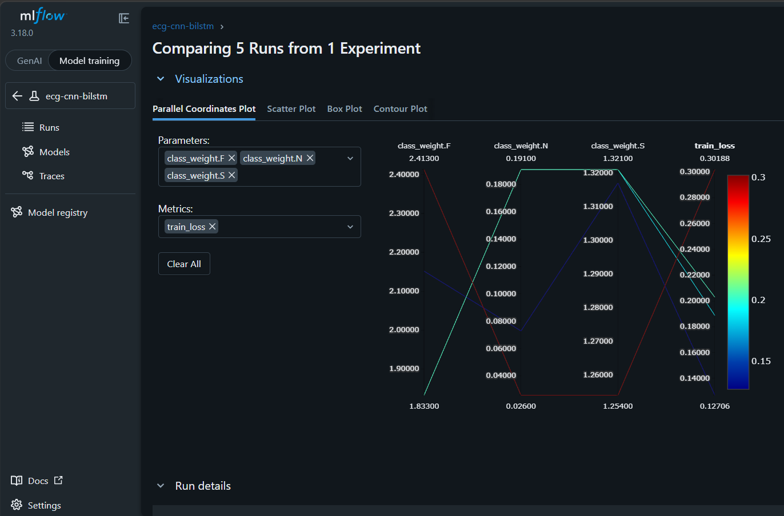

# mlops-gitops-ecg

[](https://github.com/eya-lakhal/mlops-gitops-ecg/actions/workflows/ci.yml)
[](https://github.com/eya-lakhal/mlops-gitops-ecg/actions/workflows/infra.yml)

Plateforme MLOps de bout en bout pour la **détection d'anomalies cardiaques sur ECG** (base MIT-BIH, modèle
CNN-BiLSTM) : de l'entraînement suivi dans MLflow jusqu'au déploiement canary d'un nouveau modèle sur Kubernetes,
avec un SLO de 99 %, des alertes Discord, de l'autoscaling, un suivi de dérive et une infrastructure Azure en Terraform.

Tout tourne sur un poste Windows (Docker Desktop + kind), sans cloud payant ; l'environnement Azure est décrit en
Terraform et validé en CI.

## Architecture



**Principe directeur** : Git est la source de vérité. La CI n'a aucun accès au cluster ; elle publie une image
scannée et écrit son tag dans Git. ArgoCD tire cet état et l'applique. Un retour arrière est un `git revert`.

## Résultats clés

| Domaine | Résultat |
|---|---|
| Modèle (test inter-patient, DS2) | macro-F1 **0,427 → 0,468** (v1 → v4) ; F1 classe V **0,76 → 0,87** ; accuracy 0,86-0,91 |
| Chaîne CI/CD | tests 1 min, build + scan + push 3 min ; **0 CVE HIGH/CRITICAL corrigeable** dans l'image |
| GitOps | `git push` → nouveau Pod en production en ~5 min, sans `kubectl` ; rollback par `git revert` en **28 s** |
| Self-heal | modification manuelle (`kubectl scale`) annulée par ArgoCD en **< 3 s** |
| Exercice de panne | 30 % d'erreurs injectées → alerte critique en ~7 min → Discord → correction GitOps en 2 min ([postmortem](docs/postmortem-2026-11-20-erreurs-predict.md)) |
| Charge (k6, 8 min) | **14 159 requêtes, 0 erreur**, p95 = **10,9 ms** ; HPA 2 → 3 Pods à 70 % CPU puis retour à 2 |
| Dérive (Evidently) | capteur bruité : confiance du modèle **0,86 → 0,61** et anomalies prédites ×2, détectées sans étiquettes |
| Canary (Argo Rollouts) | modèle v4 promu en 5 min après analyse Prometheus réussie ; une 1re tentative mal calibrée a été **annulée automatiquement** |
| Sécurité IaC | Trivy a bloqué une API Kubernetes ouverte à Internet (CRITICAL) avant tout déploiement |

## Aperçu

**Grafana : SLO et budget d'erreur.** Le modèle servi est la **v4**, déployée par canary. La disponibilité mesurée
(98,36 %) et le budget négatif (-64 %) sont la trace de l'exercice de chaos : 30 % d'erreurs volontaires sur un volume
de trafic encore faible suffisent à dépasser le budget « mensuel ». Le SLO joue son rôle : il rend visible le coût
d'un incident. Burn rate actuel : 0, donc aucune erreur dans l'heure écoulée.



**Grafana : signaux RED et signaux du modèle.** Pic de 40 req/s pendant le test k6 (10:00), puis trafic constant
pendant le canary (10:20-10:35) ; latence p95 de l'ordre de 10 ms ; part d'anomalies prédites et confiance moyenne du modèle.



**ArgoCD : application `ecg-api-dev`.** *Synced* et *Healthy* sur le dernier commit, synchronisée automatiquement. On voit
le Rollout, l'AnalysisTemplate du canary et les trois révisions (v1 stable, canary annulé, canary promu).



**MLflow : comparaison des 5 runs** (poids de classe, perte d'entraînement) qui ont mené au modèle v4.



## Les 10 phases

| # | Phase | Où regarder |
|---|---|---|
| 1 | Entraînement CNN-BiLSTM suivi dans MLflow, découpage inter-patient, Model Registry + alias `@champion` | [src/ecg/train.py](src/ecg/train.py), [params.yaml](params.yaml) |
| 2 | API FastAPI instrumentée Prometheus, image Docker multi-stage non-root | [src/ecg/api.py](src/ecg/api.py), [Dockerfile](Dockerfile) |
| 3 | CI/CD : tests, helm lint, build, scan Trivy, push GHCR, mise à jour GitOps du tag | [.github/workflows/ci.yml](.github/workflows/ci.yml) |
| 4 | Kubernetes local (kind) + Helm + ArgoCD, self-heal | [charts/ecg-api](charts/ecg-api), [deploy/argocd](deploy/argocd) |
| 5 | kube-prometheus-stack, SLO 99 % avec budget d'erreur, alertes de burn rate sur Discord | [prometheusrule.yaml](charts/ecg-api/templates/prometheusrule.yaml), [runbook](docs/runbook.md) |
| 6 | HPA sur le CPU + test de charge k6 dans le cluster | [hpa.yaml](charts/ecg-api/templates/hpa.yaml), [load/k6](load/k6) |
| 7 | Déploiement canary du modèle v4 avec Argo Rollouts et analyse Prometheus | [rollout.yaml](charts/ecg-api/templates/rollout.yaml), [analysistemplate.yaml](charts/ecg-api/templates/analysistemplate.yaml) |
| 8 | Dérive des données avec Evidently (nouveaux patients, capteur bruité, tachycardie) | [src/ecg/drift.py](src/ecg/drift.py), [summary.json](reports/drift/summary.json) |
| 9 | Terraform : AKS sur Azure for Students, durci et validé en CI | [infra/terraform/azure](infra/terraform/azure) |
| 10 | Documentation : architecture, problèmes rencontrés, postmortem, questions d'entretien | [docs/](docs) |

### 1. Entraînement suivi avec MLflow

- **Évaluation honnête** : découpage **inter-patient** de de Chazal (DS1 entraînement/validation, DS2 test, aucun
  patient commun). Un découpage aléatoire par battement donne ~99 % par fuite de données.
- **Données** : dérivation MLII filtrée 0,5-40 Hz, 256 points autour du pic R + 4 features RR, 4 classes AAMI (N, S, V, F).
- **MLflow** : paramètres, courbes, matrice de confusion, commit Git, signature ; chaque run crée une version du
  Registry, et l'alias `@champion` n'avance que si le macro-F1 de test progresse (une régression ne peut pas être promue).
- `--set section.cle=valeur` lance une expérience sans modifier `params.yaml` ; la valeur est tracée dans MLflow.

| Version | Changement | Accuracy | Macro-F1 | Rappel S | F1 V | Promu |
|---|---|---|---|---|---|---|
| v1 | référence | 0,907 | 0,427 | 0,00 | 0,76 | ✅ puis remplacé |
| v2 | poids de classe complets, dropout 0,5 | 0,742 | 0,390 | 0,11 | 0,66 | ❌ régression bloquée |
| v3 | + augmentation du signal | 0,910 | 0,442 | 0,00 | 0,82 | ✅ puis remplacé |
| **v4** | augmentation + poids 0,75 | 0,864 | **0,468** | 0,12 | **0,87** | ✅ **champion** |
| v5 | augmentation + lr 0,0005 | 0,918 | 0,425 | 0,00 | 0,75 | ❌ |

**Limite assumée** : la classe S reste mal reconnue chez des patients inconnus, comme dans une bonne partie de la
littérature en inter-patient. Repondérer ne crée pas d'information ; la piste suivante est un RR normalisé par patient.

### 2. API de prédiction conteneurisée

- **Une image = un modèle** : `ecg.export` sort le `@champion` de MLflow (poids `state_dict` + métadonnées + SHA-256).
- **Chargement sûr** : `torch.load(weights_only=True)` (pas d'exécution de code) et refus de démarrer si le SHA-256 diffère.
- **Routes** : `POST /predict` (1-256 battements validés par Pydantic), `/health` (liveness), `/ready` (readiness), `/model`, `/metrics`.
- **Métriques** : RED (`http_requests_total`, `http_request_duration_seconds`) à cardinalité bornée, et métier
  (`ecg_predictions_total`, `ecg_prediction_confidence`, `ecg_model_info`).
- **Image** : multi-stage, torch CPU, UID 10001 sans shell, pip/setuptools retirés, racine en lecture seule possible.

### 3. CI/CD et GitOps

```
 test (ruff + pytest) ───┐
                         ├─► build ─► scan Trivy ─► push GHCR ─► gitops : commit du tag dans deploy/envs/dev
 helm lint + promtool ───┘            (barrière)    sha-xxxxxxx           (ArgoCD synchronise le cluster)
```

Actions épinglées par **SHA de commit**, permissions minimales par job, Dependabot, rapport Trivy dans l'onglet
*Security*, tags d'image immuables. Une modification de `deploy/` ou `infra/` ne reconstruit pas l'image.

### 4. Kubernetes local et ArgoCD

Cluster kind (1 control-plane + 1 worker), ArgoCD v3.6.1 installé par Helm. Deux AppProjects : `ecg` (ce dépôt
uniquement, namespaces `ecg-*`) et `platform` (supervision, metrics-server, Argo Rollouts, ressources de cluster).
Applications en `automated` avec `prune` + `selfHeal`.

### 5. Observabilité, SLO et alertes

- **SLO** : 99 % des `POST /predict` sans 5xx sur 30 jours → budget d'erreur de 1 %.
- **Alertes multi-fenêtres, multi-burn-rate** (SRE Workbook) : *fast burn* 14,4× (1 h et 5 min) ou 6× (6 h et 30 min) → critique ;
  *slow burn* 3× (1 j et 2 h) ou 1× (3 j et 6 h) → avertissement ; `EcgApiDown` (plus aucune cible) ; latence p95.
- **Routage** : seules les alertes `team="ecg"` partent sur Discord ; webhook stocké dans un Secret hors Git.
- **Dashboard as code** : livré par le chart (ConfigMap détectée par le sidecar Grafana) ; règles validées par `promtool` en CI.
- **Chaos engineering** : `faultRate` injecte des erreurs pour tester toute la chaîne ([postmortem](docs/postmortem-2026-11-20-erreurs-predict.md)).

### 6. Autoscaling et test de charge

HPA `autoscaling/v2` sur le CPU (cible 60 % des requests, 2 à 5 Pods, montée rapide, descente stabilisée sur 120 s).
Le Deployment ne déclare pas `replicas` quand le HPA est actif (sinon ArgoCD et le HPA se battraient).
Le test k6 tourne **dans le cluster** (Job → Service) avec un débit imposé et des seuils alignés sur le SLO.

### 7. Déploiement canary du modèle

Le Deployment devient un **Rollout** Argo : paliers 25 % → 50 % → 75 % → 100 % (proportion de Pods), avec une
**analyse en arrière-plan** sur les seuls Pods canary (label `rollouts-pod-template-hash` copié sur les métriques) :
taux de succès ≥ 99 % (le SLO), p95 ≤ 0,5 s, et **confiance moyenne du modèle ≥ 0,6** (un modèle qui répond 200
mais hésite sur tout est aussi une régression). Un échec annule le déploiement et revient à 100 % sur la version stable.

Déploiement réel du modèle v4 (trafic k6 constant de 5 req/s pendant le canary) :

| Tentative | Déroulé | Résultat |
|---|---|---|
| 1 (`sha-bbb66bf`) | analyse lancée 1 min après le Pod canary : mesures `NaN` (Pod pas encore collecté) | **annulée automatiquement** en 1 min 20, retour à 100 % sur v1 (faux négatif, voir [problèmes](docs/problemes-rencontres.md)) |
| 2 (`sha-e63cd64`) | `initialDelay` porté à 2 min 30 ; paliers 25 → 50 → 75 % | **promue à 100 %** en 5 min 10 : succès 100 %, p95 9,9 ms, confiance 0,92 (6 mesures chacune) |

Dans les deux cas, la sécurité a fonctionné : dans le doute, la nouvelle version est retirée, sans intervention humaine.

### 8. Dérive des données

`python -m ecg.drift` compare les battements d'entraînement (DS1) à trois populations, à l'aide de 8 descripteurs
interprétables et des sorties du modèle, et trace les rapports dans MLflow (expérience `ecg-drift`).

| Scénario | Confiance moyenne | Anomalies prédites | Colonnes les plus touchées |
|---|---|---|---|
| Référence DS1 | 0,861 | 8,4 % | (référence) |
| DS2, nouveaux patients | 0,855 | 9,2 % | morphologie et RR : **la dérive inter-patient existe déjà**, ce qui explique la difficulté sur S |
| Capteur bruité | **0,606** | **17,1 %** | énergie haute fréquence (distance ×50), confiance, classe prédite |
| Tachycardie | 0,845 | 9,4 % | RR absolus (distance ×7) ; les ratios RR, eux, ne bougent pas |

Lecture : la **confiance du modèle** et la part d'anomalies prédites (déjà exposées dans Grafana) sont des
signaux d'alerte précoces disponibles **sans étiquettes** ; le rapport Evidently indique ensuite quelle variable a bougé.

### 9. Terraform sur Azure for Students

AKS (plan de contrôle gratuit, `Standard_B2s_v2`, 1-2 nœuds), identité managée + Workload Identity, RBAC Entra ID
avec comptes locaux désactivés, CNI overlay + Cilium, **API restreinte à des IP déclarées (obligatoire)**, budget
de 20 € avec alertes, mises à jour automatiques. Validé en CI (`fmt`, `validate`, Trivy config) sans aucun accès Azure.
Détails : [infra/terraform/azure/README.md](infra/terraform/azure/README.md).

## Démarrage rapide

```powershell
# 1. Modèle
python -m venv .venv
.venv\Scripts\python -m pip install torch --index-url https://download.pytorch.org/whl/cpu
.venv\Scripts\python -m pip install -e ".[train,api,dev,drift]"
.venv\Scripts\python -m pytest
.venv\Scripts\python -m ecg.train
.venv\Scripts\python -m ecg.export

# 2. Cluster et GitOps
kind create cluster --config infra/kind/cluster.yaml
helm upgrade --install argocd oci://ghcr.io/argoproj/argo-helm/argo-cd --version 10.18.1 `
  -n argocd --create-namespace -f infra/argocd/values.yaml --wait --timeout 15m
kubectl create namespace monitoring
kubectl -n monitoring create secret generic grafana-admin --from-literal=admin-user=admin --from-literal=admin-password=<mot de passe>
kubectl -n monitoring create secret generic alertmanager-discord --from-literal=webhook-url=<URL du webhook>
kubectl apply -f deploy/platform/ -f deploy/argocd/

# 3. Interfaces (un terminal chacune)
kubectl -n argocd port-forward svc/argocd-server 8080:80
kubectl -n monitoring port-forward svc/kps-grafana 3000:80
kubectl -n argo-rollouts port-forward svc/argo-rollouts-dashboard 3100:3100

# 4. Charge
kubectl -n ecg-dev create configmap k6-predict --from-file=load/k6/predict.js --from-file=samples/beats.json
kubectl -n ecg-dev apply -f load/k6/job.yaml
```

## Problèmes rencontrés

Le journal complet (symptôme → cause → solution → leçon) est dans
[docs/problemes-rencontres.md](docs/problemes-rencontres.md). Les plus instructifs :

1. **Une accuracy de 91 % qui cachait un modèle aveugle** aux classes rares : passage au macro-F1 et au rappel par classe.
2. **Trivy a bloqué la première image** : 5 CVE HIGH, dont des copies de `wheel` et `jaraco.context` cachées dans
   `setuptools/_vendor`, invisibles dans `pip list`.
3. **ArgoCD ne s'installait pas** : un hook Helm `pre-install` dépassait le délai sur une connexion lente ; l'erreur
   visible (`resource type "applications"` inconnu) était trois étapes plus loin que la cause.
4. **Un générateur de trafic silencieux** a fait perdre 21 minutes pendant l'exercice de panne : un `port-forward`
   ne suit pas le rolling update. D'où le test de charge déplacé dans le cluster.
5. **Docker Desktop bloqué après un redémarrage** par des sockets Unix orphelins que Windows ne sait pas supprimer ;
   le bouton proposé (« Reset to factory defaults ») aurait effacé le cluster.
6. **Terraform azurerm v5** exigeait de nouveaux blocs (`node_provisioning_profile`, `tenant_id`) ; et Trivy a signalé
   une API AKS ouverte à Internet, corrigée en rendant la liste d'IP obligatoire.
7. **Evidently 0.7 incompatible avec pandas 3** : version épinglée dans l'extra `drift`.
8. **Premier canary annulé à tort** : l'analyse mesurait le Pod canary avant que Prometheus l'ait collecté (`NaN`).
   Distinguer « mauvaise valeur » et « pas encore de valeur » est le fil rouge de plusieurs incidents du projet.

## Postmortem

[Exercice de chaos du 20 novembre 2026](docs/postmortem-2026-11-20-erreurs-predict.md) : 30 % d'erreurs sur
`/predict`, détection en ~7 min, notification Discord, correction par `git revert` appliquée en 28 s, et un
enseignement inattendu sur l'observabilité de l'outillage de test lui-même. Format *blameless*, avec chronologie
et actions correctives.

## Documentation

- [docs/runbook.md](docs/runbook.md) : une procédure par alerte, liée depuis chaque notification Discord
- [docs/problemes-rencontres.md](docs/problemes-rencontres.md) : journal des incidents et des choix techniques
- [docs/questions-entretien.md](docs/questions-entretien.md) : 30 questions d'entretien (3 par phase) avec pistes de réponse

## Limites et suites possibles

- Modèle : classe S peu reconnue en inter-patient → RR normalisés par patient, apprentissage par patient (*fine-tuning*).
- Image de 1,5 Go (PyTorch) → export ONNX + `onnxruntime` (~300 Mo, moins de CVE).
- Canary par proportion de Pods → répartition exacte du trafic avec un Ingress (NGINX, Gateway API) ou un maillage de services.
- Dérive : calcul hors ligne → capture d'un échantillon des entrées de production et rapport planifié (CronJob).
- Secrets créés à la main → Sealed Secrets ou External Secrets + Azure Key Vault.
